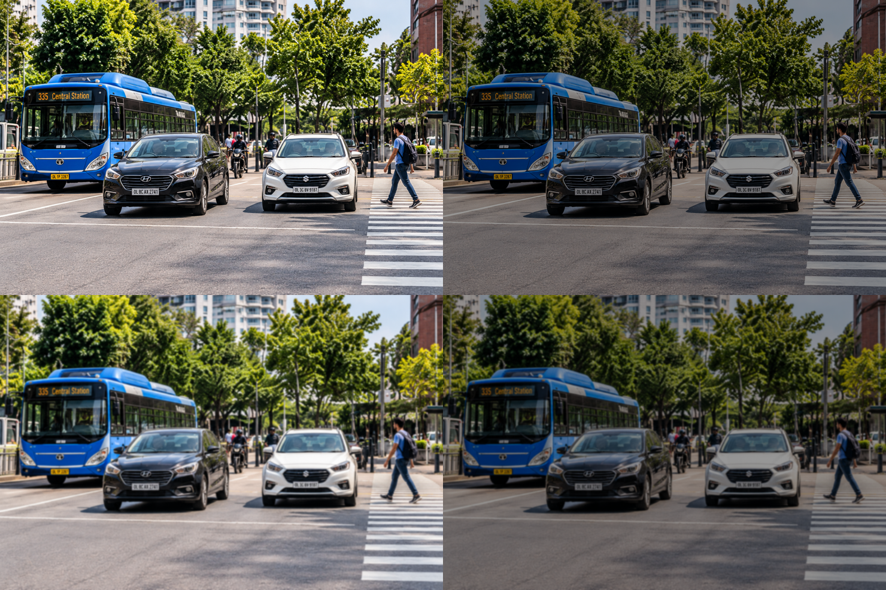
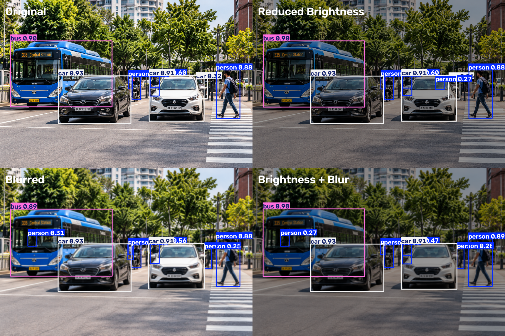
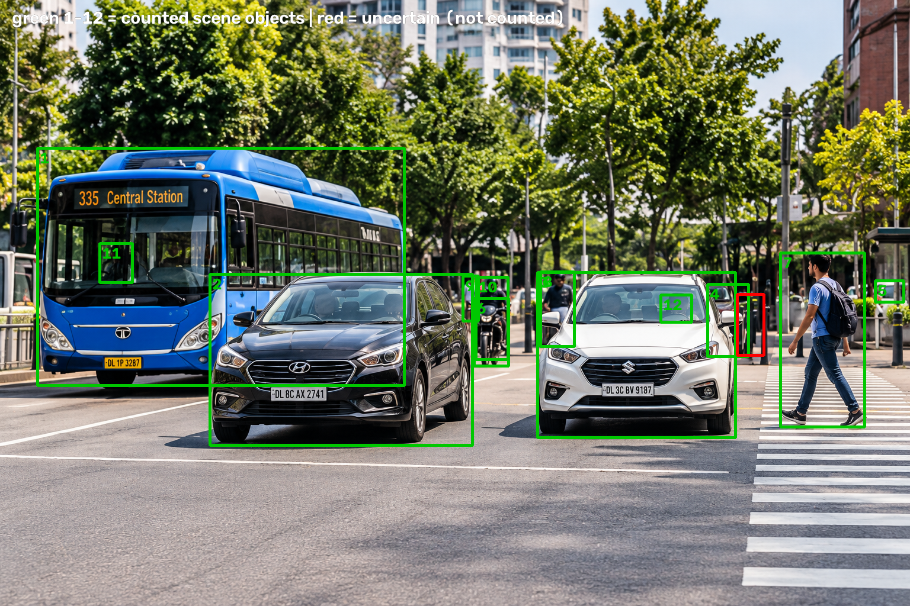
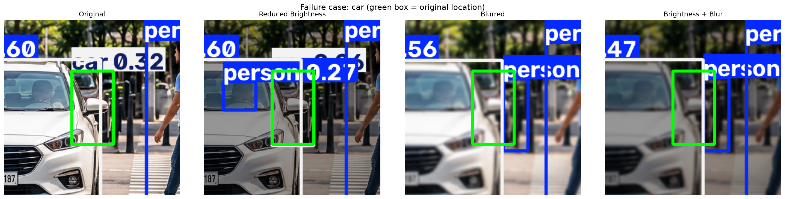
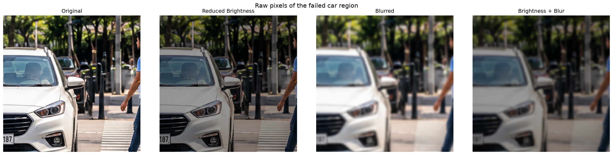

# Assignment 1 - Experimental Analysis of YOLO Object Detection

Course: CO4 | Programming Assignment from CO4_Assignment.pdf | Final experiment run: 24 October 2026 | Device: CPU

## 1. Objective and Methodology

The assignment asks for a YOLO-based detection system whose behaviour is compared when the same input image is modified. One real street-scene image (1536 x 1024 px) containing a bus, three cars, several people and a motorcycle was detected four times with the same pretrained model, changing only the input image. The experiment was executed in the Jupyter notebook Assignment1_YOLO_Experiment.ipynb, and every number below comes from that run. At the operating confidence threshold the model detects 8 unique objects in the original (a bus, three cars and four people); the motorcycle itself, the bus driver, car occupants and several partly-hidden people are present in the scene but never detected in any condition - section 4 inventories them so the missed-object denominator is explicit.

Fixed settings for all four conditions: model yolo11n.pt (COCO-pretrained, no training), confidence threshold 0.25, inference size 640 px, device CPU. Each condition was inferred 3 times after a warm-up run and the mean wall-clock time (measured around the full predict call) is reported; the supporting table also gives the standard deviation.

**Counting rule (important for the missed-object column).** The model sometimes draws two overlapping boxes for one physical object - the original image itself contains one such duplicate pair. Detections are therefore evaluated at three levels: raw *boxes* (the "Objects detected" column), *baseline objects* (unique objects detected in the original image), and objects that are visibly present in the scene but never detected. Boxes of the same class that overlap with IoU >= 0.5 are first merged into one physical object; a baseline object counts as **missed only when no box of the modified condition overlaps any of its boxes**. "Missed objects" is therefore measured against the baseline (the objects the model can detect at all), not against every object a human can see - an object the model never detects in the original cannot be "missed" by definition. A duplicate box that merges with its twin after modification is a box-level artifact, not a lost object, and is never counted as a miss. The duplicate pair was checked visually before being merged: both boxes enclose the same standing person (one full-body box, one tighter upper-body box), not two different people.

**Ambiguity in the brief - reported, not silently resolved.** The assignment PDF lists a *MissedObjects* column for every condition, including the Original row, but never defines the term. Counting only objects lost from the original detections would make the Original row trivially zero, so a second reading is also reported: missed objects relative to a 12-object inventory of everything visibly present in the scene (section 4.2). Both readings are given side by side in Table 5 and in outputs/missed_objects_both_readings.csv; neither is presented as the single correct answer.

## 2. Input and Modified Images

*Figure 1: The four inputs - Original, Reduced Brightness, Blurred, and Brightness + Blur (same scene, left to right, top to bottom).*

Table 1: Image-quality measurements of the four inputs (higher Laplacian variance means sharper edges).

| Condition | Mean brightness | Laplacian variance |
| --- | --- | --- |
| Original | 116.66 | 1415.7 |
| Reduced Brightness | 69.6 | 511.1 |
| Blurred | 116.66 | 19.4 |
| Brightness + Blur | 69.6 | 8.2 |

All four files show the same scene with identical dimensions. The brightness modification lowers the mean pixel intensity from 116.66 to 69.6, while blur keeps brightness but collapses the Laplacian variance from 1415.7 to 19.4, confirming that sharp edges and texture are removed. The three supplied modified files were used as the official inputs; a small demo showing how they can be reproduced with OpenCV (convertScaleAbs alpha=0.6, GaussianBlur 31 x 31, sigma 15) is saved in outputs/demo_regenerated/.

## 3. Detection Results

*Figure 2: YOLO11n detections for all four conditions with bounding boxes, class labels and confidence scores.*

**Original:** bus x1 [0.90]; car x3 [0.93, 0.91, 0.32]; person x5 [0.88, 0.60, 0.42, 0.37, 0.31]

**Reduced Brightness:** bus x1 [0.90]; car x3 [0.93, 0.91, 0.26]; person x6 [0.88, 0.60, 0.43, 0.40, 0.30, 0.27]

**Blurred:** bus x1 [0.89]; car x2 [0.93, 0.91]; person x7 [0.88, 0.56, 0.41, 0.35, 0.31, 0.25, 0.25]

**Brightness + Blur:** bus x1 [0.90]; car x2 [0.93, 0.91]; person x7 [0.89, 0.47, 0.39, 0.34, 0.29, 0.28, 0.27]

The four annotated full-resolution images are saved as outputs/detections/01_original_detections.png through 04_brightness_plus_blur_detections.png.

## 4. Performance Comparison

Table 2: Required performance comparison across the four conditions (measured values from the executed notebook). Objects detected counts raw boxes; Missed objects uses Reading A - baseline objects (detected in the original) that are no longer detected in that condition (see the counting rule in section 1). Table 5 gives the second, scene-inventory reading.

| Condition | Objects detected | Average confidence | Inference time (ms) | Missed objects |
| --- | --- | --- | --- | --- |
| Original | 9 | 0.6269 | 402.0 | 0 |
| Reduced Brightness | 10 | 0.5888 | 373.6 | 0 |
| Blurred | 10 | 0.5746 | 381.9 | 1 |
| Brightness + Blur | 10 | 0.5680 | 368.3 | 1 |

Table 3: Supporting analysis that separates physical objects from raw boxes and classifies the extra boxes of Table 2.

| Condition | Physical objects detected (of 8) | Duplicate boxes | New or partial-counterpart boxes | Inference time std (ms) |
| --- | --- | --- | --- | --- |
| Original | 8 | 1 | 0 | 81.7 |
| Reduced Brightness | 8 | 1 | 1 | 16.7 |
| Blurred | 7 | 1 | 2 | 19.6 |
| Brightness + Blur | 7 | 1 | 2 | 6.4 |

Average confidence decreases steadily from 0.6269 (Original) to 0.5888 (Reduced Brightness), 0.5746 (Blurred) and 0.5680 (Brightness + Blur). In baseline-object terms (Table 3), all 8 baseline objects detected in the original stay detected under Original and Reduced Brightness, while Blurred and Brightness + Blur each lose exactly one baseline object - the small distant car.

**Why the modified images show 10 boxes while the original shows 9.** The original's 9 boxes already cover only 8 physical objects, because one standing person is boxed twice (duplicate pair, IoU 0.580). Each modified image then shows 10 boxes = 7-8 physical objects + 1 duplicate box + 1-2 new boxes. Every extra box is classified in Table 3 and inspected visually in section 7: they fall on people who really exist in the scene but scored below the 0.25 threshold in the original (measured counterparts: bus driver 0.171, white-car occupant 0.235), plus one partially occluded figure that cannot be confirmed (its original score is only 0.037). In other words, the count rises because borderline scores cross the threshold in both directions - a new person box at another location does not compensate for the car that was lost.

### 4.1 What is in the scene versus what the model detects (baseline inventory)

The 8 baseline objects are what the model detects in the original image - they are not the total number of objects in the scene. The scene visibly also contains a motorcycle in the middle of the road (with its rider), the bus driver behind the windshield, occupants inside the two foreground cars, a white vehicle partly cut off at the right image edge, and people standing further back. None of these are detected in any of the four conditions. To show this is a threshold effect and not a missing object, the model was re-run on the original image at a purely diagnostic lower threshold (conf >= 0.03); the experiment itself always uses conf >= 0.25. The measured best scores are below.

Table 4: Baseline inventory - real objects the model never detects at the operating threshold, so they are excluded from the Missed-objects denominator by definition.

| Object present in scene | Best score in original (diagnostic) | Detected in any condition (conf >= 0.25)? |
| --- | --- | --- |
| motorcycle (with rider, centre of road) | 0.07 | no |
| same bike, mis-seen as 'bicycle' | 0.128 | no |
| bus driver (behind windshield) | 0.171 | no |
| white-car occupant (behind glass) | 0.235 | no |
| figure behind bollards (right of car) | 0.037 | no |
| white vehicle cut off at right edge | 0.205 | no |

The motorcycle is the clearest case: in the original image the model scores it at only 0.070 when it sees it as a 'motorcycle' and 0.128 when it labels the same bike a 'bicycle' - both far below the 0.25 operating threshold, and neither label reaches that threshold in any of the four conditions. This is why the assignment's Missed-objects column is measured against the 8 objects the model can detect, not against everything a human can see in the photo; the motorcycle's absence is a fixed property of this detector on this scene, not an effect of the brightness or blur modification.

### 4.2 Both readings of "missed objects" (the brief leaves the term undefined)

Because the PDF asks for a MissedObjects value in the Original row yet never defines the term, both readings are reported rather than silently choosing one. Reading A (Table 2) counts objects lost from the original detections. Reading B counts objects visibly present in the scene that the model fails to detect in that condition - the usual object-detection meaning of a false negative, and non-zero even for the Original row.

Table 5: The two readings of "missed objects" side by side. Reading A isolates the effect of the modification; Reading B is the scene-level false-negative count.

| Condition | Reading A: missed vs original detections (of 8) | Reading B: missed vs scene inventory (of 12) |
| --- | --- | --- |
| Original | 0 | 4 |
| Reduced Brightness | 0 | 3 |
| Blurred | 1 | 4 |
| Brightness + Blur | 1 | 4 |

Reading B uses the 12-object scene inventory below, established by inspecting zoomed crops of the original image. Each object was matched with the same rule used everywhere else (same class, IoU >= 0.5). One judgement call is stated openly: a figure behind the bollards to the right of the distant car is excluded from the inventory because its identity could not be confirmed (it is listed separately and marked uncertain). The white vehicle partly cut off at the right edge is counted, flagged as partially visible.

*Figure 3: The 12-object scene inventory drawn on the original image (green = counted objects, numbered as in Table 6; red = the uncertain figure behind the bollards, excluded from the count).*

Table 6: The 12-object scene inventory and its detection status in each condition. Objects 5, 6, 11 and 12 are never detected at conf >= 0.25 in any condition.

| No. | Class | Object (visible in original) | Region (x1, y1, x2, y2) | Original | Reduced Bright. | Blurred | Bright.+Blur |
| --- | --- | --- | --- | --- | --- | --- | --- |
| 1 | bus | blue city bus (left) | (63, 250, 682, 651) | yes | yes | yes | yes |
| 2 | car | black car (foreground left) | (354, 463, 797, 752) | yes | yes | yes | yes |
| 3 | car | white car (foreground right) | (907, 460, 1241, 739) | yes | yes | yes | yes |
| 4 | car | distant maroon car behind the white car (the failure case) | (1194, 480, 1263, 602) | yes | yes | no | no |
| 5 | car | white vehicle partly cut off at the right edge | (1477, 474, 1525, 510) | no | no | no | no |
| 6 | motorcycle | motorcycle with rider (centre of road) | (800, 504, 858, 618) | no | no | no | no |
| 7 | person | pedestrian with backpack (right) | (1317, 427, 1459, 721) | yes | yes | yes | yes |
| 8 | person | standing person behind (boxed twice in the original) | (912, 459, 969, 585) | yes | yes | yes | yes |
| 9 | person | person in white shirt behind the rider | (781, 466, 807, 542) | yes | yes | yes | yes |
| 10 | person | motorcycle rider | (803, 468, 857, 607) | yes | yes | yes | yes |
| 11 | person | bus driver behind the windshield | (168, 411, 223, 477) | no | no | yes | yes |
| 12 | person | occupant behind the white-car windshield | (1115, 498, 1167, 544) | no | yes | no | no |
| - | person | figure behind bollards - identity NOT confirmed [EXCLUDED] | (1244, 497, 1289, 600) | - | - | - | - |

Reading B makes two points that Reading A cannot. First, several objects are missed in **every** condition - white vehicle partly cut off at the right edge, motorcycle with rider (centre of road) - so those absences are fixed blind spots of this detector on this scene, not effects of the modifications. Second, under blur the Reading B total stays at 4 of 12, identical to the Original row, only because the lost distant car is offset by the bus driver's score crossing the threshold under blur. A single scene-inventory number would therefore **hide** the damage blur caused; Reading A (0 -> 1 baseline object lost) is what isolates the modification's effect. This is exactly why the undefined term is reported twice.

The condition means span only 368-402 ms, with standard deviations of 6.4-81.7 ms over 3 timed runs per condition, and the individual run times overlap between conditions (e.g. Blurred 355-400 ms vs Brightness + Blur 362-377 ms). Since all inputs have identical dimensions and every other setting is fixed, the small differences between the condition means are treated as measurement noise; no effect of the image content on speed and no performance improvement is claimed.

## 5. Object-Level Investigation of Two Objects

Object A is the largest bus instance (a large, prominent object) and Object B is the smallest vehicle instance in the original image (a small, distant object partially hidden behind the white car). The selection rule was fixed before running the conditions, and both crops were inspected visually in the notebook. Confidence changes follow the assignment formula: delta_C = C_original - C_modified. For undetected objects in a modified condition, the confidence is reported as 'missed/N/A' and observed delta_C is recorded as 'N/A' (since no modified detection exists from which to compute a difference). Under a hypothetical convention where missing is assigned confidence 0, delta_C would equal the object's full original score (0.3205); both perspectives are detailed below.

Table 7: Two-object investigation across the four conditions.

| Object | Condition | Detected | Confidence | delta_C | IoU vs original box | Center shift (px) | Width change (%) | Height change (%) | Bounding box |
| --- | --- | --- | --- | --- | --- | --- | --- | --- | --- |
| Object A (bus, large) | Original | Detected | 0.9021 | 0.0 | 1.0 | 0.0 | 0.0 | 0.0 | (63, 250, 682, 651) |
| Object A (bus, large) | Reduced Brightness | Detected | 0.8993 | 0.0028 | 0.992 | 1.2 | -0.2 | 0.4 | (65, 249, 682, 652) |
| Object A (bus, large) | Blurred | Detected | 0.8922 | 0.0099 | 0.977 | 4.3 | 0.0 | 1.8 | (64, 250, 682, 659) |
| Object A (bus, large) | Brightness + Blur | Detected | 0.8969 | 0.0052 | 0.974 | 4.5 | -0.0 | 2.3 | (65, 249, 682, 660) |
| Object B (car, small) | Original | Detected | 0.3205 | 0.0 | 1.0 | 0.0 | 0.0 | 0.0 | (1194, 480, 1263, 602) |
| Object B (car, small) | Reduced Brightness | Detected | 0.262 | 0.0585 | 0.969 | 1.3 | 1.2 | 1.0 | (1193, 480, 1263, 603) |
| Object B (car, small) | Blurred | Missed | missed/N/A | N/A | 0.0 | - | - | - | not detected |
| Object B (car, small) | Brightness + Blur | Missed | missed/N/A | N/A | 0.0 | - | - | - | not detected |

**Object A (bus, large)** is detected in all four conditions. Its confidence barely moves (0.9021 -> 0.8993 / 0.8922 / 0.8969), so observed delta_C stays at most 0.0099. The box overlap with the original stays at IoU >= 0.974 and the box centre moves no more than 4.5 px.

**Object B (car, small)** shows the opposite behaviour. It is detected in the Original image with confidence 0.3205 and in Reduced Brightness with 0.262 (observed delta_C = 0.0585, box still overlaps with IoU 0.969). Under Blurred and Brightness + Blur the object is **missed**: its modified confidence is recorded as 'missed/N/A' and observed delta_C is 'N/A'. (Under a hypothetical convention where missing is treated as confidence 0, delta_C would equal the full original confidence 0.3205.)

## 6. Failure-Case Analysis

*Figure 4: The failed object (green box = original location) in all four conditions. The distant car is detected with confidence 0.32 in the Original, keeps a low-confidence box under Reduced Brightness, and disappears once the image is blurred.*

*Figure 5: Raw, unannotated pixels of the same region. In the Original and Reduced Brightness panels the dark car behind the white car has visible boundaries; under blur its outline dissolves into the dark background and the bollards.*

The clearest failure is a **car detected with confidence 0.3205 in the Original image (box [1193.8, 479.7, 1262.8, 601.6]) that is missed in the 'Blurred' condition** (observed delta_C = N/A; hypothetical delta_C = 0.3205 under a zero-confidence convention). In that condition no car-class box overlaps the original location anymore (best same-class IoU 0.062), and the closest box of any class is a low-confidence 'person' (0.2536) that overlaps the original location only partially (IoU 0.175). That person box sits over the bollard area partly overlapping the car's right edge, so it is reported as a nearby detection; it is *not* treated as proof that the model relabelled the car as a person, because the overlap is too small to establish this. What is certain is that no car box survives the blur. The same car is also missed in Brightness + Blur (observed delta_C = N/A), so the failure is reproducible rather than a one-off.

Image-quality measurements explain why: blur leaves mean brightness unchanged (116.66 -> 116.66) but reduces the Laplacian variance from 1415.7 to 19.4, i.e. the fine edges that carried the object's evidence are largely gone. The car is small and distant - it covers only about 8,400 pixels - and its discriminative features are the windshield line, the lights and the contrast between the dark body and the dark background behind the white car, exactly the detail Gaussian blur removes (Figures 4 and 5). With that evidence smoothed away, the score that was only 0.32 in the Original falls below the fixed 0.25 threshold. This is an interpretation consistent with the measurements, not a proven causal chain; by contrast the large bus and the two foreground cars keep strong edges under blur and lose at most 0.01 confidence.

A separate box-level observation: the original image draws the standing person twice (duplicate pair, IoU 0.580) and under Blurred only one box remains at that spot. Because the person is still detected there, this merge is **not** counted in the Missed objects column; it is documented as a duplicate-box effect in Table 3.

## 7. Observations and Conclusion

*Figure 6: Visual verification of the extra boxes (annotated crops, original next to the modified condition). Top to bottom: the bus driver (a real person, below threshold in the original), the white-car occupants (real, below threshold), the partially occluded figure behind the bollards (uncertain), and the double-boxed motorcyclist (duplicate box).*

1. **Reduced brightness alone is well tolerated.** All 8 baseline objects stay detected (0 missed under Reading A), only the average confidence falls from 0.6269 to 0.5888, and the weakest car drops from 0.32 to 0.26 but remains above the 0.25 threshold. Under Reading B its missed count falls from 4 to 3 of 12, because the modification pushed the white-car occupant's score above the threshold.

2. **Blur is the damaging factor.** Each blur condition loses exactly one physical object - the small distant car - and the average confidence falls further to 0.5746 (Blurred) and 0.5680 (Brightness + Blur). The combined condition does not remove additional objects beyond blur alone.

3. **Why both readings are reported, and why they disagree.** Under Reading B the Blurred condition misses 4 of 12 scene objects - the same total as the Original row - only because the lost car is offset by the bus driver's score crossing the threshold under blur. A single scene-inventory number would therefore hide the damage blur caused; Reading A (0 -> 1 baseline object lost) is what isolates the modification's effect. The brief does not define "missed objects", so both are reported.

4. **Object size decides robustness.** The large bus changes by at most delta_C = 0.0099 and keeps IoU >= 0.974 in every condition; the small distant car is missed under blur (observed delta_C = N/A; hypothetical delta_C = 0.3205 under a zero-confidence convention).

5. **The modified conditions add 1-2 low-confidence boxes each** (1 in Reduced Brightness, 2 in Blurred and 2 in Brightness + Blur; Table 3), which is why the raw box count rises to 10 even though an object is being missed. Figure 6 shows that these are not invented objects: the bus-window box and the white-car box fall on real people who were below the 0.25 threshold in the original (a borderline-score effect), while the figure behind the bollards cannot be confirmed with certainty. Every condition also contains exactly one duplicate box on an already detected object.

6. **Inference time is not affected by the image content** beyond measurement noise (means of 3 runs per condition, standard deviations of 6.4-81.7 ms); all inputs have identical dimensions and all other settings are fixed. The three modified conditions' per-run ranges overlap each other, while the Original condition's first timed run is a clear cold-start outlier, so with only 3 runs per condition these mean differences cannot be separated from system noise. No speed effect of the image content and no performance improvement is claimed.

Conclusion: on this image and this model, moderate brightness reduction changes the detector's confidence only slightly, while blur - especially combined with reduced brightness - degrades small and low-contrast objects first, because it destroys the edges and texture the detector relies on; the large, high-contrast bus is essentially unaffected. The findings are limited to YOLO11n, one scene and these specific modifications; they do not generalise to other models or scenes.

## 8. References and Experiment Settings

Model: yolo11n.pt (COCO-pretrained (no training or fine-tuning in this assignment)); device: cpu; confidence threshold: 0.25; image size: 640; runs per condition: 3; IoU match threshold: 0.5; timing method: wall-clock around model.predict, mean of 3 timed runs after 1 warm-up run. Package versions: ultralytics 8.4.184, opencv-python 5.0.0.93, torch 2.14.1, numpy 2.4.6, pandas 3.1.0, matplotlib 3.11.2, pillow 13.0.0.

1. Assignment brief: CO4_Assignment.pdf, Assignment-I (CO4).
2. J. Redmon, S. Divvala, R. Girshick, A. Farhadi. You Only Look Once: Unified, Real-Time Object Detection. CVPR 2016.
3. Ultralytics. Ultralytics YOLO documentation. https://docs.ultralytics.com/
4. Ultralytics. YOLO11 model card. https://docs.ultralytics.com/models/yolo11/
5. COCO 80 class labels. https://docs.ultralytics.com/datasets/detect/coco/
6. OpenCV documentation: cv2.GaussianBlur, cv2.convertScaleAbs.

**Image source — unverified.** The four input PNGs carry no EXIF or embedded text metadata (verified chunk-by-chunk), and no source is recorded anywhere in the project files. To preserve academic and scientific integrity, no attribution or author origin is invented, and the origin remains unverified.
